# J.A.R.V.I.S. B8 — BATCH 7 BASELINE REVIEW (`B8_B7_BASELINE_REVIEW.md`)

- **Project Name**: J.A.R.V.I.S. Mobile & Multi-AI Intelligence Platform (`com.jarvis.mobile.assistant` / `jarvis-api`)
- **Document Role**: Pre-Batch 8.1 Mandatory Baseline Review & Architectural Audit (Part 1 & Step 4 Deliverable)
- **Execution Date**: 2026-11-06
- **Baseline Source Reference**: `All Access Jarvis B7 Final (2).md` (`1,317,571` bytes, `28,749` lines, `178` bundled files)
- **Local Unpacked Repository Commit**: `aca88d1d48e5543ccf3ea9d7b940eda5bb3b6faf` (`main` branch)
- **Baseline Automated Verification Status**: **PASS (`136/136` automated runtime tests; `24/24` Kotlin static checks; `63/63` JS/MJS syntax checks; `178/178` SHA-256 file integrity checks)**
- **Android APK Compilation Status**: **BLOCKED in Sandbox VM** (Java 17 is installed, but `gradle`, `kotlinc`, Android SDK 35, and outbound Maven network access are unavailable in the offline sandbox)
- **Live GitHub Remote Comparison Status**: **BLOCKED in Sandbox VM** (Sandbox VM has no outbound network access or GitHub credentials to query `https://github.com/levinn68/jarvismobile.git` directly; comparison is performed against the embedded B6/B7 manifests and workflows inside the supplied bundle)

## 1. B7 Document Review Summary

The supplied master artifact `All Access Jarvis B7 Final (2).md` (`1,317,571` bytes, `28,749` lines) was inspected in its entirety from line 1 to line 28,749 and unpacked into `/working_dir/c_a66b72b1f5bf63c8/repo`. Every single one of the **178 embedded files** was verified byte-for-byte against its declared size and SHA-256 checksum (`0` mismatches).

The B7 document consolidates:
1. **Six Mandatory B7 Reports**:
   - `BATCH_7_CHANGELOG.md` (41 modified files, 5 added files, 2 legacy size-probe files archived to B6 backup, 132 unchanged files).
   - `BATCH_7_FIX_REPORT.md` (Remediation of Audit 1 `C-01`..`C-04`, `H-01`..`H-10`, `M-01`..`M-10`, `L-01`..`L-08`, `S-01`..`S-07` and Audit 2 `CRIT-01`..`CRIT-05`, `HIGH-01`..`HIGH-08`, `MED-01`..`MED-10`).
   - `BATCH_7_TEST_REPORT.md` (Automated verification across Cloudflare Worker and Windows/macOS/Linux desktop agents).
   - `BATCH_7_SECURITY_REPORT.md` (Supply-chain prompt injection removal, `SECURITY INVOKER` SQL triggers, CORS origin allowlisting, pairing session revocation, UTF-8 byte-length checks, HTTPS-only image URLs, child process env sanitization, and per-credential random scrypt salts).
   - `BATCH_7_REMAINING_ISSUES.md` (Operational boundaries for offline sandbox environments: `OPS-01` Android APK build, `OPS-02` Wrangler deploy, `OPS-03` Supabase migration push, `OPS-04` Desktop service registration).
   - `BATCH_7_RELEASE_STATUS.md` (Subsystem readiness matrix).
2. **Two Specialized B7 Repair Reports**:
   - `BATCH_7_FULL_FRONTEND_REPAIR_REPORT.md` (`15,714` bytes): Documents the ROG Phone 6 HUD overhaul, full Chat Mode markdown/table/code rendering without truncation, 7-state `HolographicOrb`, `voiceConciseSummary`, and `stopSpeaking()` interruption.
   - `BATCH_7_GOOGLE_AUTH_FIX_REPORT.md` (`14,802` bytes): Documents the 7-stage Google Sign-In & Supabase Auth pipeline (`AUTH_CONFIG_VALIDATION` through `AUTH_SUCCESS`), fixing the `Authorization: Bearer sb_publishable_...` rejection bug and adding `TYPE_GOOGLE_ID_TOKEN_SIWG_CREDENTIAL` support.
3. **Complete 178-File Source Bundle**:
   - **Android App (`app/`, 35 files)**: 24 Kotlin source files (`.kt`), 6 XML resource/manifest files, 1 Gradle script (`app/build.gradle.kts`), and 2 `mainactivity_parts` files.
   - **Cloudflare Worker (`worker/`, 53 files)**: 34 ES module source files (`worker/src/**`), 5 core skill markdown files (`worker/skills/*.md`), 13 automated test suites (`worker/test/*.test.js`), `package.json`, `wrangler.toml`, and 2 device platform docs.
   - **Desktop Companion Agents (`desktop/`, 14 files)**: Windows (`desktop/windows/`), macOS (`desktop/macos/`), and Linux/Unix (`desktop/unix/`) agents, credential vaults, test suites, and sync script.
   - **Supabase Database (`supabase/`, 7 files)**: `supabase/config.toml` and 6 ordered PostgreSQL migration files (`20261103095224` through `20261105161000`).
   - **Bundled Skill Library (`skills/`, 29 files + `manifest.json` + `JARVIS_SKILL_ROUTER.md`)**: 29 modular `SKILL.md` specifications.
   - **CI/CD Workflows & Tooling (18 files)**: 8 GitHub Actions workflows (`.github/workflows/*.yml`), Gradle wrapper files, docs, and helper scripts.

## 2. Existing B7 Architecture Overview

```mermaid
flowchart TD
    subgraph Android["Android Client (com.jarvis.mobile.assistant)"]
        MA["MainActivity.kt (4,431 LOC)<br/>Chat Console + Voice HUD"]
        ORB["HolographicOrb.kt + JarvisDesignSystem.kt<br/>7 Orb States + HUD Palette"]
        CHAT["JarvisChatComponents.kt<br/>Bubbles, Error Cards, Composer"]
        AUTH["SupabaseJarvisClient.kt + SupabaseSessionVault.kt<br/>Credential Manager + Keystore AES-GCM"]
        DEV["DeviceCommandExecutor.kt + JarvisDeviceSyncService.kt<br/>App/File/Contact/Calendar/Notification/Screen Control"]
        ACC["JarvisAccessibilityService.kt + ScreenActionApprovalActivity.kt<br/>On-Device Approval Gate + HandlerThread Gestures"]
    end

    subgraph Worker["Cloudflare Worker (jarvis-api)"]
        IDX["worker/src/index.js<br/>/health, /v1/chat, /v1/tts, /v1/skills, /v1/search/*"]
        AIC["AI Council & Key Rotator<br/>gemini, deepseek, groq, openai, openrouter"]
        SKR["worker/src/skills/skill-registry.js<br/>29 Bundled Local Skills"]
        DROUT["worker/src/device/router.js + command-service.js + pairing.js<br/>HMAC Tokens, QR Pairing, KV Command Queue"]
        KV1[("KV: DEVICE_REGISTRY")]
        KV2[("KV: DEVICE_COMMANDS")]
    end

    subgraph Supabase["Supabase Backend"]
        SBAUTH["Supabase GoTrue Auth<br/>/auth/v1/token & /auth/v1/user"]
        SBDB[("PostgreSQL + RLS<br/>jarvis_conversations & jarvis_messages")]
    end

    subgraph Desktop["Desktop Companion Agents"]
        WIN["Windows Agent (desktop/windows)<br/>Start Menu + DPAPI + PowerShell -FilePath"]
        MAC["macOS Agent (desktop/macos)<br/>/Applications + Keychain + /usr/bin/open"]
        LIN["Linux Agent (desktop/unix)<br/>.desktop + libsecret + gio launch"]
    end

    MA --> AUTH
    MA --> ORB
    MA --> CHAT
    MA --> DEV
    DEV --> ACC
    AUTH -->|Google ID Token Exchange & PostgREST| SBAUTH
    AUTH -->|CRUD Conversations & Messages| SBDB
    MA -->|Bearer Supabase JWT: /v1/chat, /v1/tts| IDX
    IDX -->|Verify User Token| SBAUTH
    IDX --> AIC
    IDX --> SKR
    IDX --> DROUT
    DROUT --> KV1
    DROUT --> KV2
    DEV -->|Poll & Ack Commands| DROUT
    WIN -->|Poll & Ack Commands| DROUT
    MAC -->|Poll & Ack Commands| DROUT
    LIN -->|Poll & Ack Commands| DROUT
```

### 2.1. Android Application (`app/`)
- **`MainActivity.kt` (`236,644` bytes, `4,431` lines)**:
  - **Responsibilities**: Hosts the entire Jetpack Compose UI (`JarvisScreen`), lifecycle management, `SpeechRecognizer` continuous loop, `ClapPatternDetector` (single/double clap wake), `TextToSpeech` + Fish Audio MP3 streaming playback (`speak()`, `stopSpeaking()`), HTTP `/v1/chat` client (`askGemini()`), local vs. remote device intent routing (`parseDeviceCommand()`, `isRemotePlatformTargeted()`), and Supabase account/history dialogs.
  - **Existing Chat Mode**: Supports full Markdown parsing (`parseMarkdownBlocks`: headings, paragraphs, code blocks with copy button, VS comparison tables, product tables, ordered/unordered bullets, inline HTTPS images), up to 5 file/photo/camera attachments (`pendingAttachments`), error cards with retry (`JarvisChatErrorCard`), and action strips (`Salin`, `Dengar`, `Bagikan`, `SourceStrip`).
  - **Existing Voice Mode**: Renders the dual-layer `HolographicOrb` + `VoiceHudReactor`, 29-bar waveform visualizer, `VoiceHudClock`, pill voice/text input bar, concise summary box (`voiceConciseSummary`, max 3 lines), up to 5 visual/product cards (`ProductCarouselCards` / `VoiceImageCarouselCards`), speech interruption button (`HENTIKAN SUARA` / `BATALKAN`), and bottom 3-button dock (`MIC OFF`, `LISTENING`, `CHAT`).
  - **Navigation Model in B7**: Strictly 2-mode toggle (`CORE 01 / CHAT` and `CORE 01 / VOICE`) with an empty-chat `JarvisHomeDashboard` (3x3 category grid + 3 Quick Commands) and a `RESET CHAT` header button.
- **`HolographicOrb.kt` (`9,616` bytes), `JarvisDesignSystem.kt` (`3,400` bytes), `JarvisChatComponents.kt` (`12,127` bytes)**:
  - Defines `JarvisColors` (`#040911` Background, `#081421` DeepCard, `#0B1A2A` Panel, `#00E5FF` Cyan, `#26F0FF` CyanGlow, `#8B5CFF` Violet), `JarvisShapes`, `JarvisSpacing`, and `VoiceOrbState` (`Idle`, `Standby`, `Listening`, `Processing`, `Responding`, `Speaking`, `Muted`, `Error`).
- **Authentication & Supabase Integration (`SupabaseJarvisClient.kt`, `SupabaseSessionVault.kt`)**:
  - Uses Android `CredentialManager` with `GetSignInWithGoogleOption`, supports both `TYPE_GOOGLE_ID_TOKEN_CREDENTIAL` and `TYPE_GOOGLE_ID_TOKEN_SIWG_CREDENTIAL`, validates JWT structure/audience, exchanges the token via `/auth/v1/token?grant_type=id_token` (sending `apikey` without invalid `Bearer sb_publishable_...`), and stores tokens encrypted with Android Keystore AES-GCM in `SupabaseSessionVault`.
  - Persists conversations (`jarvis_conversations`) and messages (`jarvis_messages`) with deterministic UUIDv3 client IDs and an offline queue (`jarvis_chat_offline`) flushed automatically via `ConnectivityManager.NetworkCallback`.
- **Android Device-Control & Accessibility Services (`app/src/main/java/com/jarvis/mobile/device/`)**:
  - `AppController.kt` (`apps.list`, `apps.launch`, `apps.launch_label`), `FileController.kt` (SAF `files.list`, `files.search`, `files.read` capped at 60 KB), `DeviceController.kt` (`system.status`), `NotificationController.kt` + `JarvisNotificationListener.kt` (`notifications.list`), `ContactController.kt` (`contacts.list`), `CalendarController.kt` (`calendar.list`), `CameraController.kt` (local preview intent).
  - `JarvisAccessibilityService.kt` + `ScreenActionApprovalActivity.kt`: Gates `screen.read`, `screen.tap`, and `screen.type` behind an explicit on-device user confirmation dialog with `FLAG_SECURE`, `filterTouchesWhenObscured = true`, and a dedicated `HandlerThread("JarvisGestureCallback")` to prevent main-thread deadlocks.
  - `JarvisDeviceSyncService.kt`: Foreground `dataSync` service with 30-second bounded `PARTIAL_WAKE_LOCK` and exponential backoff (`15s -> 30s -> 60s -> 120s`).
  - `DeviceSetupActivity.kt` & `PairingQrActivity.kt`: HUD-styled Android Views activities for Google-linked device enrollment, 8-character QR pairing session creation, status polling, and server-side session cancellation.

### 2.2. Cloudflare Worker (`worker/`)
- **Entry Point (`worker/src/index.js`, `62,267` bytes)**:
  - Exposes `GET /`, `GET /health`, `GET /v1/skills`, `POST /v1/chat`, `POST /v1/tts`, `POST /v1/search/products`, `POST /v1/search/images`, and delegates `/v1/accounts/*`, `/v1/devices/*`, `/v1/pairing/*`, and `/v1/device/*` to `handleDeviceRequest` (`worker/src/device/router.js`).
- **AI Routing, Providers & Key Rotation (`worker/src/ai/`)**:
  - Supports 5 server-side providers configured via Worker Secrets (`_1`, `_2`, `_3` key slots): `gemini` (`gemini-2.5-flash` with automatic 404 fallback to `gemini-2.0-flash`), `deepseek` (`deepseek-chat`), `groq` (`openai/gpt-oss-120b`), `openai` (`gpt-4.1-mini`), and `openrouter` (`openai/gpt-4.1-mini`).
  - `key-rotation.js` implements per-key failure cooldowns and a per-provider circuit breaker persisted to `DEVICE_REGISTRY` KV (`ai:rotator:state:v1`).
  - Multi-agent AI Council in `handleChat`: classifies prompts into `simple` (1 agent, 1 round), `medium` (2 agents + 1 reviewer, 2 rounds), or `complex` (up to 5 agents + 2 reviewers, 3 rounds + moderator synthesis).
- **TTS, Visuals, Device Routing, Skills & Security**:
  - `POST /v1/tts`: Bilingual (`id`/`en`) Fish Audio streaming (`s2.1-pro-free`) with automatic `fallback: "android_tts"` payload on error.
  - Visuals: SerpApi Google Shopping & Google Images integration + `buildTopicalFallbackVisuals()` guaranteeing 1–5 HTTPS visual cards (`MAX_VISUAL_CARDS = 5`) on every response.
  - Skills: All 29 skills bundled locally in `BUNDLED_SKILL_INSTRUCTIONS` (`worker/src/skills/skill-registry.js`) with zero external GitHub fetches and `MAX_SYSTEM_PROMPT_CHARS = 18000`.
  - Security: `request-guard.js` enforces Supabase JWT verification (`/auth/v1/user`), KV fixed-window rate limiting (`chat`: 30/min, `tts`: 20/min, `search`: 15/min, `pair_redeem_ip`: 20/min), `JARVIS_ALLOWED_ORIGINS` CORS enforcement, and prompt-injection pattern detection.

### 2.3. Supabase Database (`supabase/migrations/`)
- Six ordered SQL migrations (`20261103095224` to `20261105161000`):
  - Tables: `public.jarvis_conversations` (`id`, `user_id`, `title`, `message_count`, `last_message_at`, `created_at`, `updated_at`) and `public.jarvis_messages` (`id`, `conversation_id`, `user_id`, `role`, `content`, `client_id`, `sequence_number`, `created_at`).
  - Enforces composite foreign key `jarvis_messages(conversation_id, user_id) -> jarvis_conversations(id, user_id) ON DELETE CASCADE`, `ENABLE` + `FORCE ROW LEVEL SECURITY`, separate `SELECT`/`INSERT`/`UPDATE`/`DELETE` policies for `authenticated`, `REVOKE ALL FROM PUBLIC, anon`, and `SECURITY INVOKER` triggers (`jarvis_enforce_immutable_columns`, `jarvis_prepare_message_insert`, `jarvis_touch_conversation_updated_at`).
  - Drops obsolete `levpay_*` objects and quarantines generic `paid_*` tables.

### 2.4. Desktop Companion Agents (`desktop/windows/`, `desktop/macos/`, `desktop/unix/`)
- **Windows (`desktop/windows/src/agent.js`, `39,470` bytes)**: Discovers `.lnk`/`.appref-ms` Start Menu shortcuts, launches apps via `powershell.exe ... Start-Process -FilePath $env:JARVIS_TARGET` (`shell: false`), isolates file operations to `JARVIS_ALLOWED_DIRS` (`MAX_FILE_BYTES = 60 * 1024`), protects tokens with Windows DPAPI (`ProtectedData::Protect`) or AES-256-GCM fallback with per-write random 16-byte scrypt salt, and outputs `schtasks` config via `--print-service-config`.
- **macOS (`desktop/macos/src/agent.js`, `44,494` bytes) & Linux/Unix (`desktop/unix/src/agent.js`, `44,494` bytes)**: Byte-for-byte synchronized POSIX implementation; discovers macOS `.app` bundles (`Info.plist`) and Linux `.desktop` entries, launches via `open` (macOS) or `gio launch` (Linux), protects tokens via macOS Keychain (`/usr/bin/security -i`) or Linux `secret-tool` (`libsecret`) with AES-256-GCM `0600` fallback, and outputs `launchd` plist / `systemd --user` service units via `--print-service-config`.

## 3. Actual Repository Comparison & Verification

| Verification Dimension | B7 Documentation Claim | Observed State in Unpacked Repository | Status |
| :--- | :--- | :--- | :--- |
| **Total Bundled Files** | `178` files in `All Access Jarvis B7 Final (2).md` | `178` files extracted; `178/178` match exact byte size and SHA-256 hash | **PASS (100% Match)** |
| **Worker Automated Tests** | `107` tests in `worker/test/*.test.js` (`BATCH_7_FULL_FRONTEND_REPAIR_REPORT.md`) | Executed `npm test --prefix worker`: **107/107 PASS** across 13 test files in `5.04s` | **PASS** |
| **Windows Agent Tests** | `9` tests in `desktop/windows/test/agent.test.js` | Executed `npm test --prefix desktop/windows`: **9/9 PASS** in `0.58s` | **PASS** |
| **macOS Agent Tests** | `10` tests in `desktop/macos/test/agent.test.js` | Executed `npm test --prefix desktop/macos`: **10/10 PASS** in `0.63s` | **PASS** |
| **Linux/Unix Agent Tests** | `10` tests in `desktop/unix/test/agent.test.js` | Executed `npm test --prefix desktop/unix`: **10/10 PASS** in `0.57s` | **PASS** |
| **Kotlin Source Files** | `24` `.kt` files under `app/src/main/java/com/jarvis/mobile/` | All `24` `.kt` files present, valid package declarations, balanced braces, and verified imports | **PASS (Static)** |
| **JS/MJS Syntax Check** | `63` `.js`/`.mjs` files across `worker/`, `desktop/`, `tools/` | Executed `node --check` on all `63` files: **63/63 PASS** | **PASS** |
| **Minor Metadata Drift Found** | `mainactivity_parts/MANIFEST.json` claims `MainActivity.kt` size `210,688` B | Actual `MainActivity.kt` is `236,644` B (`05c4f89d2b52...`) after B7 frontend overhaul; `MANIFEST.json` was not updated after the last B7 edit | **IDENTIFIED (Fix in B8)** |
| **Live Remote GitHub Diff** | Target repository `levinn68/jarvismobile` | Sandbox VM has no outbound internet access; git repository initialized locally on `main` (`aca88d1`) from the canonical B7 final bundle | **DOCUMENTED BOUNDARY** |

## 4. Existing Features and Verified Status (B7 Baseline)

| Subsystem / Feature | Verified Status | Evidence / Test Coverage |
| :--- | :--- | :--- |
| **Google OAuth + Supabase Session Exchange** | **FUNCTIONAL (PASS)** | 7-stage diagnostic flow verified in `batch7-google-auth.test.js` (16 test cases). |
| **Supabase Conversation & Message Persistence** | **FUNCTIONAL (PASS)** | RLS policies, composite FK, monotonic ordering, and offline queue verified in `batch4-full-backend.test.js`. |
| **Chat Mode (Markdown, Tables, Code, Attachments)** | **FUNCTIONAL (PASS)** | Full response preservation, VS tables, code copy, and error retry cards verified in `batch7-frontend-overhaul.test.js`. |
| **Voice Mode (7-State Orb, Wake Word, Clap, TTS)** | **FUNCTIONAL (PASS)** | 7 `VoiceOrbState` states, concise summary card, max 5 visual cards, and `stopSpeaking()` verified. |
| **Visual Card System (Max 5 Cards + HTTPS Fallback)** | **FUNCTIONAL (PASS)** | `MAX_VISUAL_CARDS = 5` and `buildTopicalFallbackVisuals` verified in `batch7-audit-remediation.test.js`. |
| **Cloudflare Worker Multi-Provider AI Council** | **FUNCTIONAL (PASS)** | 5 providers (`gemini`, `deepseek`, `groq`, `openai`, `openrouter`), key rotation, and circuit breaker verified. |
| **QR & Manual Desktop Pairing + Revocation** | **FUNCTIONAL (PASS)** | Create, poll, redeem, cancel, and revoke flows verified in `pairing.test.js` and `batch5-desktop-integration.test.js`. |
| **Android Device Control & On-Device Approval Gate** | **FUNCTIONAL (PASS)** | `apps.*`, `files.*`, `notifications.list`, `contacts.list`, `calendar.list`, `screen.*` verified in `device-screen-control.test.js`. |
| **Windows, macOS & Linux Companion Agents** | **FUNCTIONAL (PASS)** | Path traversal, symlink/TOCTOU defenses, app launch, and credential vaults verified across 29 desktop tests. |
| **Bundled 29-Skill Router** | **FUNCTIONAL (PASS)** | Local `BUNDLED_SKILL_INSTRUCTIONS` and selective routing verified in `regression-audit.test.js`. |

## 5. Gap Analysis: B7 Baseline vs. B8 Requirements & 40-Screen Storyboards

Inspection of the 4 supplied B8 visual storyboard sheets (**40 screens total**) and the B8 batch requirements in Parts 4 & 5 reveals the exact gap between the B7 baseline and the target B8 architecture:

### 5.1. Storyboard Sheet 1 (`file_00000000ebbc82079b6c7c5780cbabf2.png` — Screens 1 to 10: Onboarding, Login, Initialization & Dashboard)
1. **Screen 1 — Splash Screen (`v8.0.0`, `Initializing...`)**: B7 only has a static XML drawable splash (`jarvis_splash.xml`). B8 requires an animated Compose Splash Screen with progress bar and `v8.0.0` version indicator.
2. **Screen 2 — Welcome / Onboarding (`Welcome to J.A.R.V.I.S.`)**: Missing in B7. B8 requires a 4-feature onboarding screen (`Multi-AI & Multi-Model`, `Kolaborasi Antar-AI`, `MCP & Skills Ecosystem`, `Kontrol Perangkat Android`) with `Mulai ->` CTA.
3. **Screen 3 — Login (`Login ke J.A.R.V.I.S.`)**: B7 uses a basic `AlertDialog` for Google login only. B8 requires a dedicated full-screen Login view supporting `Lanjut dengan Google`, `Lanjut dengan GitHub`, `Lanjut dengan Email`, and `Gunakan sebagai Guest`.
4. **Screen 4 — Login Sukses (`Login Berhasil!`)**: Missing in B7. B8 requires a confirmation screen transitioning into system initialization.
5. **Screens 5–9 — First-Login System Initialization Sequence (`42%` -> `68%` -> `Core Online` -> `55% Mengaktifkan Chat Mode` -> `78% Menambahkan Voice & Kolaborasi`)**: Missing in B7. B8 requires a multi-stage animated initialization sequence (`System Initialization`, `Core Formation`, `Core Ready`, `Fitur: Chat`, `Fitur: Voice & Kolaborasi`).
6. **Screen 10 — Fitur Lengkap (Dashboard / `Beranda`)**: B7 has a 2-tab bottom bar (`CHAT | VOICE`). B8 requires a **5-tab bottom navigation bar** (`Beranda`, `Chat`, `Voice`, `Kolaborasi`, `Pengaturan`) and a rich `Beranda` dashboard with active model banner (`JARVIS 4 — APEX`), 6 primary module cards (`Chat`, `Voice`, `Kolaborasi`, `Models`, `Skills`, `MCP`), and a `Ringkasan Sistem` telemetry card (`Provider aktif`, `Akun`, `MCP Server`, `Skills`).

### 5.2. Storyboard Sheet 2 (`file_000000003a508211ac7f9866f7bb8e11.png` — Screens 11 to 20: Daily Usage — Beranda, Chat, Voice & History)
1. **Screen 11 (2.1) — Beranda (Ringkasan)**: Active model selector card (`JARVIS 4 — APEX`), 2x3 module grid, and `Ringkasan Sistem` counters.
2. **Screens 12–14 (2.2–2.4) — Chat Mode (`JARVIS 3 — SPARK`)**: Header with active model tier subtitle (`JARVIS 3 — SPARK`), suggestion pills on empty state, structured architecture diagram cards in responses, and composer with `+`, `Kirim pesan...`, attachment, mic, and send buttons.
3. **Screens 15–19 (2.5–2.9) — Voice Mode (`Siap Mendengarkan`, `Mendengarkan...`, `Memproses...`, `Berikut jawabannya...`, `Voice Hasil & Aksi`)**: Step-by-step processing checklist (`Memahami perintah`, `Menyiapkan respons`, `Mengambil informasi relevan`) and actionable file output cards (`Rencana_Kerja_AI.md` with `Buka`, `Bagikan`, `Simpan` buttons) directly in Voice Mode.
4. **Screen 20 (2.10) — Riwayat Percakapan**: Full-screen searchable history view (`Cari percakapan...`) with filter chips (`Semua`, `Chat`, `Voice`) replacing B7's basic `AlertDialog`.

### 5.3. Storyboard Sheet 3 (`file_00000000b8708211a3eccd4bf17ec871.png` — Screens 21 to 30: Multi-AI Collaboration & Workflow)
1. **Screens 21–24 (3.1–3.4) — Collaboration Setup**: Entry from Dashboard (`Akses Kolaborasi`), `Kolaborasi Multi-AI` landing screen (`Diskusi Multi-Perspektif`, `Debat & Evaluasi`, `Synthesis & Kesimpulan`, `Workflow Terstruktur`), `Pilih Model AI` (up to 6 models across GPT-4o, Claude 3.5, Gemini 1.5/2.5 Pro, Llama 3.3, DeepSeek-V3, Qwen 2.5), and `Atur Sesi Kolaborasi` (topic input, discussion mode selector, role assignment `Analis`/`Kreatif`/`Teknis`/`Evaluator`/`Perencana`, `Gunakan Knowledge Graph`, `Simpan hasil ke Knowledge Base`).
2. **Screens 25–30 (3.5–3.10) — Live Collaboration & Visualizations**:
   - `Diskusi Multi-AI (Live)` with role badges and `JARVIS (Moderator)`.
   - `Debat & Evaluasi` with `Ringkasan | Pro & Kontra | Evaluasi` tabs and `Kesimpulan Sementara`.
   - `Workflow Kolaborasi` step-by-step pipeline (`1. Analisis Kebutuhan` -> `2. Eksplorasi Solusi` -> `3. Evaluasi & Perbandingan` -> `4. Rekomendasi`).
   - `Knowledge Graph` interactive node-link diagram + `Grafik | Tabel | Detail` view switcher.
   - `Synthesis & Hasil Akhir` with expandable sections (`Rekomendasi Utama`, `Rencana Implementasi`, `Risiko & Mitigasi`) and export actions (`Laporan (PDF)`, `Rencana (MD)`, `Diagram (PNG)`).
   - `Riwayat Kolaborasi` searchable session list.

### 5.4. Storyboard Sheet 4 (`file_0000000040a88211bda229658de29964.png` — Screens 31 to 40: Models, Providers, Multi-Accounts, MCP, Skills, Settings & Security)
1. **Screen 31 (4.1) — Model Selector (`Models`)**: Filter tabs (`Semua`, `Teks`, `Vision`, `Kode`), JARVIS model tiers (`CORE`, `PULSE`, `SPARK`, `APEX`), and underlying models (`GPT-4o`, `Claude 3.5 Sonnet`, `Gemini 1.5/2.5 Pro`, `Llama 3.3 70B`, `DeepSeek-V3`).
2. **Screen 32 (4.2) — AI Providers**: Provider list (`OpenAI`, `Anthropic`, `Google (Gemini)`, `Meta (Llama)`, `DeepSeek`, plus OpenRouter/Groq) with toggle switches, connection status, account counts, and `+ Tambah Provider`.
3. **Screen 33 (4.3) — Multi-Accounts**: Per-provider account management (`Akun Utama`, `Akun Work`, `Akun Riset`), active/inactive status, `+ Tambah Akun`, and quota/token usage progress bar (`Kuota & Penggunaan`).
4. **Screen 34 (4.4) — MCP Servers**: MCP server manager (`Filesystem MCP`, `GitHub MCP`, `Notion MCP`, `Playwright MCP`) with global toggle, status badges, and `+ Tambah MCP Server`.
5. **Screens 35–36 (4.5–4.6) — Skills Marketplace & Skill Detail**: Tabs (`Marketplace`, `Terpasang`, `Buatan Saya`), skill cards (`AI Researcher`, `Document Analyst`, `Android Dev Assistant`, `Data Scientist`, `Task Automator`), and `Detail Skill` screen with version, tags, capabilities checklist, and `Pasang Skill` button.
6. **Screens 37–40 (4.7–4.10) — Pengaturan, Keamanan & Privasi, Status Sistem, Tentang J.A.R.V.I.S.**:
   - `Pengaturan`: `Akun & Profil`, `AI & Model`, `MCP & Integrasi`, `Skills & Ekstensi`, `Tampilan & UI`, `Notifikasi`.
   - `Keamanan & Privasi`: `Kunci Aplikasi` (PIN/pattern/biometric toggle), `Enkripsi Data`, `Mode Privasi`, `Kontrol Izin`, `Hapus Data`.
   - `Status Sistem`: Service health checklist (`Core Engine`, `AI Orchestration`, `Service Layer`, `MCP Services`, `Skills`, `Koneksi Provider`) + `Performa Perangkat` circular gauges (`CPU`, `RAM`, `Storage`).
   - `Tentang J.A.R.V.I.S.`: Version card (`v8.0.0`), `Apa yang Baru`, `Panduan Penggunaan`, `Dukungan & Feedback`.

## 6. Existing Technical Debt & Risks Identified in B7

1. **Monolithic `MainActivity.kt` (`4,431` lines / `236 KB`)**: Putting all 40 B8 screens inside `MainActivity.kt` would make it unmaintainable (`>10,000` lines). B8 should modularize new screens into dedicated Kotlin files under `app/src/main/java/com/jarvis/mobile/ui/` and domain packages (`ai/`, `collaboration/`, `mcp/`, `skills/`, `settings/`) while preserving `MainActivity.kt` entry-point compatibility.
2. **Server-Only Provider Keys vs. User-Configured Provider Accounts**: In B7, provider keys only exist in Cloudflare Worker Secrets (`GEMINI_API_KEY_1..3`, etc.). For B8's Provider & Multi-Account architecture, both Worker-level keys and encrypted client/account-scoped provider configurations (with connection test endpoints and fallback routing) must work seamlessly without exposing server secrets.
3. **Simulated vs. Real Multi-Provider Collaboration**: In B7, `handleChat` runs a fixed 2- or 3-round council internally and only returns the final text to the Android UI. B8 requires structured per-agent round responses, debate/pro-con extraction, workflow steps, knowledge graph nodes/edges, and synthesis payloads returned by the Worker and rendered interactively on Android.
4. **Outdated `mainactivity_parts/MANIFEST.json`**: Still references an older size/hash (`210,688` bytes) instead of the current `MainActivity.kt` (`236,644` bytes).

## 7. Database, Backend & Security Contracts to Preserve

1. **Supabase Schema & RLS**: Existing tables `public.jarvis_conversations` and `public.jarvis_messages` and their RLS policies must remain 100% backward-compatible. Any new B8 tables (e.g., for collaboration sessions, multi-accounts, MCP servers, or installed skills) must be added via a new timestamped migration (`supabase/migrations/20261106000000_jarvis_b8_*.sql`) with `ENABLE` + `FORCE ROW LEVEL SECURITY` and `SECURITY INVOKER` triggers.
2. **Worker Endpoints**: Existing endpoints (`/health`, `/v1/chat`, `/v1/tts`, `/v1/skills`, `/v1/search/products`, `/v1/search/images`, `/v1/accounts/google`, `/v1/devices*`, `/v1/pairing/*`, `/v1/device/*`) and their response fields (`ok`, `answer`, `visuals`, `diagnostics`, `events`, `discussion`) must remain intact.
3. ** preserved B7 Systems**:
   - Google authentication (`SupabaseJarvisClient` 7-stage pipeline).
   - Conversation persistence & offline queue auto-flush.
   - Chat Mode & Voice Mode (7-state `HolographicOrb`, `MAX_VISUAL_CARDS = 5`, Fish Audio + Android TTS fallback).
   - Device pairing, Android Accessibility approval gate (`ScreenActionApprovalActivity`), and Windows/macOS/Linux desktop companion agents.

## 8. Recommended B8 Implementation Strategy (Batches 8.1 → 8.4)

1. **Batch 8.1 — AI Foundation (`BATCH_8_1_AI_FOUNDATION.md`)**:
   - Expand `JarvisDesignSystem.kt` for B8 v8.0.0 HUD tokens, motion specs, and 5-tab navigation (`Beranda`, `Chat`, `Voice`, `Kolaborasi`, `Pengaturan`).
   - Implement Screens 1–10 (Splash, Welcome/Onboarding, Login, Login Success, First-Login Initialization Sequence 5–9, and `Beranda` Dashboard).
   - Implement Provider Architecture, Multi-Account Manager, and JARVIS Model Registry (`CORE`, `PULSE`, `SPARK`, `APEX` + custom models) across Worker (`worker/src/ai/`) and Android (Screens 31–33), with real connection testing and fallback.
2. **Batch 8.2 — Chat, Voice & Collaboration (`BATCH_8_2_CHAT_VOICE_COLLABORATION.md`)**:
   - Upgrade Chat Mode & Voice Mode to match Storyboard Sheet 2 (Screens 11–20: model badge header, architecture diagram cards, Voice processing checklist, actionable file output cards, and full-screen searchable `Riwayat Percakapan`).
   - Implement the 7-mode Collaboration Engine & Visualization suite across Worker and Android matching Storyboard Sheet 3 (Screens 21–30: Agent Network, Discussion Arena, Debate Pro/Contra, Structured Workflow, Knowledge Graph, Final Synthesis with PDF/MD/PNG export, and Collaboration History).
3. **Batch 8.3 — Extensibility & Intelligence (`BATCH_8_3_EXTENSIBILITY_INTELLIGENCE.md`)**:
   - Implement MCP Client/Server integration (Screen 34: protocol support, tool discovery, permission gate, execution, and logging).
   - Implement Skills Marketplace, Installation, Version Management & Custom Skills (Screens 35–36).
   - Implement Multimodal AI, Creative AI, Research/Productivity generators, and Settings/Security/System Status screens (Screens 37–40).
4. **Batch 8.4 — Finalization (`BATCH_8_4_FINALIZATION.md` & `B8_MASTER_FINAL_REPORT.md`)**:
   - Full integration audit across all 40 storyboard screens, Worker, Supabase migrations, Desktop agents, MCP, and Skills.
   - Full security, performance, and regression test suite execution, followed by `BATCH_8_4_FINALIZATION.md` and `B8_MASTER_FINAL_REPORT.md`.